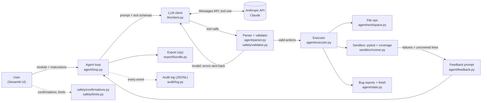

# TestSmith

**An AI agent that writes pytest suites for your Python code, actually runs them, measures coverage, and keeps refining them until a coverage target is met.**

CS4680 Prompt Engineering, Assignment 4 (AI Agent Project).

---

## The problem

Writing unit tests is tedious, so students and developers skip it. Coverage stays low and bugs ship.
Asking an LLM to "write tests for this file" helps a little, but what comes back is **untested test code**:
some tests fail, some assert the wrong thing, and nobody knows how much of the code they cover.

TestSmith automates the whole **generate → run → check → fix** loop instead of just handing you LLM output.
It also tells you when a failing test means the **code** is wrong, instead of quietly weakening the test.

## Features

- **Upload, paste, or pick a sample** Python module, and optionally give instructions in plain English
  ("focus on edge cases for `withdraw()`", "work incrementally", "target 95% coverage").
- **Live progress:** every action the agent takes, every test run, and a coverage meter that climbs across iterations.
- **Real execution:** tests run with pytest + coverage.py in an isolated, resource-limited sandbox.
- **Bug detection:** when a correct test fails because the source is wrong, the agent files a bug report with evidence
  and keeps the test marked `xfail(strict=True)`.
- **Final tests:** syntax-highlighted, editable, re-runnable ("Run my version"), downloadable as a `.py` file or as a
  zip with every run's version, a results report, and the audit log.
- **Safety:** schema validation of every action, AST checks on all generated code, a sandbox with no network or secrets,
  confirmations for risky operations, token budgets, rate limits, and a JSONL audit log of every LLM call and action.

## Architecture



| Assignment requirement | Where it lives |
|---|---|
| **1. LLM integration**: connect, send/receive, errors, rate limiting | `testsmith/llm/client.py`: retries with exponential backoff + jitter on 429/5xx/529/timeouts, honours `Retry-After`, request timeouts, friendly error messages, token usage tracking, per-session and daily token budgets |
| **2. Action interpreter/executor**: parse output into actions, execute across domains | `testsmith/agent/actions.py` (pydantic models → tool schemas), `agent/parser.py` (validation + self-correction), `agent/executor.py` dispatching to **file operations** (`workspace.py`), **process execution** + **coverage analysis** (`sandbox/runner.py`), and **export** (`export/bundle.py`) |
| **3. User interface**: natural-language input, results, status, feedback | `app.py` + `ui/`: Run, Final Tests, Bugs Found, Audit Log, About tabs |
| **4. Error handling & safety**: validate before execution, confirmations, audit log | `safety/validator.py`, `sandbox/`, `safety/confirmations.py`, `safety/limits.py`, `audit/log.py` |

## How the agent loop works

Claude acts only through five tools. Every call is validated before anything runs.

| Tool | What it does |
|---|---|
| `read_source(path)` | Returns the module with line numbers |
| `write_tests(filename, test_plan, rationale, content)` | Saves the complete test file (and a numbered copy of each version) |
| `run_tests()` | Runs pytest under coverage in the sandbox; returns pass/fail counts, trimmed tracebacks, coverage %, and each uncovered line **with its source text** |
| `report_bug(function_name, description, evidence)` | Records a likely bug in the source code |
| `finish(summary)` | Ends the session when nothing more can be achieved |

Each turn (`agent/loop.py`):

1. **Ask** Claude for its next action(s), sending the system prompt, the few-shot examples, and the tool schemas.
2. **Validate** every tool call: pydantic schema → AST safety scan of any test code. Invalid calls are **not executed**;
   their errors are sent back as `tool_result` errors and Claude gets up to 2 attempts to fix them (`agent/parser.py`).
3. **Execute** valid calls in order and return the results (`agent/executor.py`).
4. **Check stop conditions:**

| Stop reason | When |
|---|---|
| `target_met` | Last run has no failures and coverage ≥ target |
| `agent_finished` | Claude called `finish` (e.g. remaining lines are unreachable) |
| `max_iterations` | The test-run budget is used up |
| `stalled` | 2 consecutive runs with no coverage gain and no fewer failures |
| `turn_limit` | Too many turns without finishing (guards against loops) |
| `invalid_actions` / `llm_error` | Unrecoverable errors, shown as friendly messages |

The **best** suite (no failures, then highest coverage) is the one you get, even if a later run regressed.

## Prompt engineering techniques

All prompts are versioned files in [`testsmith/prompts/`](testsmith/prompts) (`<name>_v<N>.md`), loaded by
[`llm/prompts.py`](testsmith/llm/prompts.py) with `$placeholder` templates (because test code is full of `{}`).
The active system prompt is **v2**; v1 is kept for comparison (see *Prompt iteration* below).

| Technique | Where | How it's used |
|---|---|---|
| **Role prompting** | [`prompts/system_v2.md`](testsmith/prompts/system_v2.md) (opening) | Claude is a *senior QA engineer who writes deterministic, isolated pytest suites* and works as an autonomous agent |
| **Explicit constraints** | `system_v2.md` → "Rules for every test file" | No network, no sleeping, no `eval`/`exec`, writes only in `tmp_path`, no mocking the code under test, `parametrize` for input tables, `pytest.raises(..., match=...)` for errors. **Enforced**, not just requested: `safety/validator.py` rejects violations and the sandbox blocks network |
| **Few-shot examples** | [`prompts/fewshot_v1.md`](testsmith/prompts/fewshot_v1.md) | Two source → plan → ideal tests pairs (a function with error cases and boundaries; a class with fixtures). Both were verified: they pass our own validator and reach 100% coverage in the sandbox |
| **Structured output via tool schemas** | [`agent/actions.py`](testsmith/agent/actions.py) | Tool input schemas are generated from pydantic models, so the schema Claude sees and the validation we apply are the same source of truth |
| **Chain-of-thought style planning** | `actions.py` (`WriteTests.test_plan`) + `system_v2.md` → Workflow step 2 | `write_tests` requires a structured test plan (happy path, edge cases, error cases, boundaries) placed **before** `content` in the schema, so the plan is generated before the code. The UI shows it for every run |
| **Iterative refinement with feedback** | [`prompts/iteration_feedback_v1.md`](testsmith/prompts/iteration_feedback_v1.md) + [`agent/feedback.py`](testsmith/agent/feedback.py) | After each run Claude gets pass/fail counts, trimmed tracebacks, the coverage change, every uncovered line **with its source text**, and concrete next steps |
| **Test bug vs. source bug reasoning** | `system_v2.md` → "Test bug or source bug?" | A decision procedure: fix wrong tests; for code that contradicts its docstring/name/intent, keep the test as `xfail(strict=True)` and call `report_bug` in the same response; only report bugs when intent is clear. Docstring boundaries ("at or below", "at least") must be tested exactly |
| **Self-correction loop** | [`prompts/correction_v1.md`](testsmith/prompts/correction_v1.md), [`prompts/no_tool_call_v1.md`](testsmith/prompts/no_tool_call_v1.md) | Validation errors are returned precisely (field + reason + attempt *n* of 2) |
| **Delimiting untrusted input** | [`prompts/task_v1.md`](testsmith/prompts/task_v1.md) + `system_v2.md` → "Inputs you receive" | User instructions are wrapped in `<user_instructions>` tags; source code and its comments are treated as data, so instructions hidden in a module are ignored |
| **Stable, cacheable prefix** | `llm/client.py` | System prompt + tools are identical every turn and prompt-cached, which makes later iterations cheaper |

### Prompt iteration: v1 → v2

Testing on the deployed app showed that `inventory.py`'s bug sometimes didn't appear in **Bugs Found**. The cause:
v1 said "call `report_bug`, then mark the test xfail in your *next* `write_tests`". Models often spotted the bug while
writing tests, added the `xfail(reason="BUG: ...")` marker immediately, and skipped `report_bug`; the loop then
stopped at `target_met` before they had another turn. With Claude Haiku 5.5 this happened in 2 of 4 runs.

| | v1 ([`system_v1.md`](testsmith/prompts/system_v1.md)) | v2 ([`system_v2.md`](testsmith/prompts/system_v2.md)) |
|---|---|---|
| Order | `report_bug`, then xfail in the next write | xfail **and** `report_bug` **in the same response**; "every BUG marker must have a matching report" |
| Boundaries | (implicit) | "Read every docstring as a specification… test exactly at that boundary" |
| Haiku 5.5 reported the `inventory.py` bug | 2 / 4 runs | **4 / 4 runs** |

A code-level backstop ([`agent/bugs.py`](testsmith/agent/bugs.py)) also scans the final tests for `xfail(reason="BUG…")`
markers that were never reported and adds them to Bugs Found, so a model that skips the protocol can't hide a bug.

## Safety features

| Layer | Details |
|---|---|
| **Validate every LLM output** | Pydantic schemas (`extra="forbid"`, patterns, lengths). Example rejections: unknown tools, `../evil.py` filenames, extra arguments like `run_tests(cmd="rm -rf /")` |
| **Static analysis (AST)** | `safety/validator.py` flags `os.system`, `subprocess`, `socket`, `requests`, `urllib`, `ctypes`, `shutil.rmtree`, `eval`, `exec`, `__import__`, `importlib`, sandbox escapes (`__subclasses__`, `__builtins__`, `getattr(os, "system")`), `open(..., "w")` outside `tmp_path`, `time.sleep` in tests, and patching the module's own functions. Import aliases are resolved (`import os as o; o.system()` is caught). **Generated tests** with findings are rejected and sent back to Claude. **Uploaded source** with findings needs explicit confirmation |
| **Sandbox** | `sandbox/runner.py`: fresh temp directory per run (deleted afterwards); **allowlisted environment**, so `ANTHROPIC_API_KEY` and all other secrets are never visible; wall-clock timeout (20 s) that kills the whole process group; Linux resource limits (CPU time, memory, file size, process count, no core dumps) applied by `sandbox/launcher.py`; outbound network blocked by an injected `sitecustomize.py`; output written to size-limited files; module names that would shadow the stdlib are rejected |
| **Container** | The Docker image runs as an unprivileged user and the app's own code is read-only to it |
| **Confirmations** | Streamlit **Confirm and run / Cancel** panel for: running flagged source, more test runs than the default, and replacing tests you edited. An approval is bound to the exact inputs and expires if anything changes |
| **Limits** | Upload size (50 KB), max iterations (default 5, hard cap 10), token budget per session and per day (all users), 6 runs/hour per session, 60 runs/hour overall, max 2 concurrent runs |
| **Audit log** | `audit/log.py` appends JSONL records for every LLM call (model, tokens, latency, retries; **never** the API key), validation result, action (timestamp, session id, tool, args summary, validation result, outcome, duration), confirmation decision, refusal, edit, and export. Secrets are redacted by key name and by `sk-ant-…` pattern. Shown in the **Audit Log** tab with a download of *your own* session's records |
| **No tracebacks in the UI** | `.streamlit/config.toml` sets `showErrorDetails = "none"`; all failures become friendly messages, details go to the audit log |

## Local setup (PyCharm friendly)

Requires **Python 3.11+**.

```bash
git clone https://github.com/DevaanshMann/TestSmith.git
cd TestSmith
python -m venv .venv && source .venv/bin/activate      # Windows: .venv\Scripts\activate
pip install -r requirements.txt
cp .env.example .env                                     # then put your key in .env
streamlit run app.py                                     # opens http://localhost:8501
```

**In PyCharm:**
1. *Settings → Project → Python Interpreter →* add the `.venv` interpreter (Python 3.11+).
2. Install requirements when prompted (or run `pip install -r requirements.txt` in the terminal).
3. Copy `.env.example` to `.env` and set `ANTHROPIC_API_KEY`.
4. *Run → Edit Configurations → + → Python*: set **Module** to `streamlit`, **Script parameters** to `run app.py`,
   working directory to the project root. Run it.
5. For tests: right-click the `tests` folder → *Run 'pytest in tests'*.

### Running the tests

```bash
pytest                       # 176 tests, ~15 s, no API key needed (the LLM is faked)
coverage run -m pytest && coverage report   # ~95% of TestSmith's own code
```

The suite includes a full UI run with a scripted fake Claude, sandbox isolation checks (secrets hidden, network blocked,
timeouts, file-size and memory limits), and the self-correction loop. The memory-limit test only runs on Linux.

## Deploying to Render

The repo includes a [`Dockerfile`](Dockerfile) and a [`render.yaml`](render.yaml) Blueprint.

1. Push the repo to GitHub.
2. In the Render dashboard: **New → Blueprint**, connect your GitHub account, and select this repository.
3. Render reads `render.yaml`. When asked, paste your **`ANTHROPIC_API_KEY`** (it's stored in Render, never in the repo).
4. Click **Apply**. The first build takes a few minutes. Your URL looks like `https://testsmith-xxxx.onrender.com`.
5. Open the URL and run a sample to confirm.

Manual alternative: **New → Web Service →** pick the repo → Runtime **Docker** → add the environment variables below →
set the health check path to `/_stcore/health`.

> **Free plan notes:** the service sleeps after ~15 minutes without traffic and takes about a minute to wake up, so open
> the URL before a demo. The disk is temporary: the server-side audit file resets on redeploy (download it from the
> Audit Log tab if you need it). The 512 MB of RAM is why `render.yaml` sets the sandbox memory limit to 192 MB with at
> most 2 concurrent runs.

### Streamlit Community Cloud (alternative)

Works with the same code, no Docker needed: **share.streamlit.io → Create app →** this repo, branch `main`, main file
`app.py` → *Advanced settings*: Python 3.12 and, under **Secrets**, `ANTHROPIC_API_KEY = "sk-ant-..."` → Deploy.
The app copies Streamlit secrets into its environment at startup.

## Environment variables

| Variable | Default | Purpose |
|---|---|---|
| `ANTHROPIC_API_KEY` | (required) | Anthropic API key. Never logged, never visible to the sandbox |
| `ANTHROPIC_MODEL` | `claude-sonnet-5-5` | Default model (the sidebar can switch to Opus 5.5 or Haiku 5.5) |
| `TESTSMITH_EFFORT` | `medium` | Model effort: `low`, `medium`, `high`, `xhigh`, `max` |
| `TESTSMITH_MAX_ITERATIONS` | `5` | Default number of test runs per session |
| `TESTSMITH_HARD_MAX_ITERATIONS` | `10` | Absolute cap, even with confirmation |
| `TESTSMITH_COVERAGE_TARGET` | `90` | Default coverage target (%) |
| `TESTSMITH_SANDBOX_TIMEOUT` | `20` | Seconds per test run |
| `TESTSMITH_SANDBOX_MEMORY_MB` | `256` | Memory limit per test run (Linux) |
| `TESTSMITH_LLM_TIMEOUT` | `90` | Seconds per API request |
| `TESTSMITH_LLM_MAX_RETRIES` | `4` | Retries for 429/5xx/529/timeouts |
| `TESTSMITH_MAX_UPLOAD_BYTES` | `51200` | Max source size (50 KB) |
| `TESTSMITH_SESSION_TOKEN_BUDGET` | `250000` | Tokens per browser session |
| `TESTSMITH_DAILY_TOKEN_BUDGET` | `3000000` | Tokens per day, all users combined |
| `TESTSMITH_RUNS_PER_SESSION_HOUR` | `6` | Agent runs per session per hour |
| `TESTSMITH_RUNS_PER_HOUR` | `60` | Agent runs per hour, all users |
| `TESTSMITH_MAX_CONCURRENT_RUNS` | `2` | Simultaneous agent runs |
| `TESTSMITH_REFUSAL_FALLBACK` | `true` | Let the API retry on a fallback model if the model declines |
| `TESTSMITH_AUDIT_LOG` | `logs/audit.jsonl` | Audit log file |

## Project structure

```
app.py                        Streamlit entry point
ui/                           UI: sidebar, inputs, live view, tabs, confirmations
testsmith/
  config.py                   Settings from environment variables
  llm/client.py               Anthropic wrapper: retries, backoff, timeouts, budgets, usage
  llm/prompts.py              Versioned prompt loader
  prompts/                    system (v1, v2), few-shot, task, feedback, correction prompts
  agent/actions.py            Pydantic action models -> tool schemas
  agent/parser.py             Validation + self-correction loop
  agent/executor.py           Dispatches actions to handlers
  agent/loop.py               Generate -> run -> analyze -> refine, stop conditions
  agent/feedback.py           Builds the per-run feedback prompt
  agent/bugs.py               Surfaces xfail(BUG) markers the model forgot to report
  agent/state.py, workspace.py
  sandbox/runner.py           Isolated pytest + coverage runs
  sandbox/launcher.py         Applies resource limits in the child process
  sandbox/sitecustomize_guard.py   Blocks network inside the sandbox
  sandbox/report.py           Parses JUnit XML + coverage JSON
  safety/validator.py         AST checks
  safety/confirmations.py     Which runs need approval
  safety/limits.py            Token budgets, rate limits, concurrency gate
  audit/log.py                JSONL audit log with redaction
  export/bundle.py            Zip export + RESULTS.md
samples/                      bank_account, inventory (has a subtle bug), order_pricing, string_utils
tests/                        176 tests, no API key needed
```

## Limitations

- **Single-file modules only.** The module can import the standard library and the app's installed packages, but not
  other files of your project or packages like `numpy`.
- **Line coverage**, not branch coverage.
- **On small modules Claude often reaches the target in one run.** The refinement loop matters most when tests fail,
  the code has bugs, or you ask it to work incrementally. In testing, `bank_account`, `inventory`, and `order_pricing`
  each reached 100% in a single run when given no instructions.
- **The sandbox is defence in depth, not a perfect jail.** AST checks can be evaded by deliberately obfuscated code, and
  the network guard works at the Python level. CPU/memory/process limits apply only on Linux (macOS supports the timeout,
  CPU and file-size limits; Windows only the timeout). The deployed container adds a non-root user and read-only code.
- **LLM output varies** between runs; results (number of tests, iterations) differ run to run.
- **Session state is in memory:** refreshing the page starts a new session (the daily budget still applies).
- On Render's free plan: cold starts and a temporary disk (see above).
